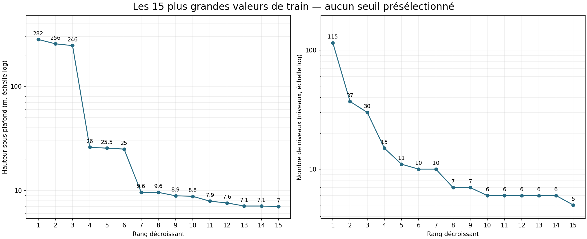

# Valeurs extrêmes dans le train

Distribution de la surface, de la hauteur sous plafond et du nombre de niveaux
sur les **47 974 diagnostics du train**, pour repérer les valeurs à vérifier.

## Distributions et boîtes à moustaches

À gauche : zoom entre P1 et P99, avec le nombre de valeurs hors cadre.
À droite : toutes les valeurs, sur un axe logarithmique.

| Variable | Médiane | P99 | Maximum dans train | Points hors règle 1,5 × IQR |
| --- | ---: | ---: | ---: | ---: |
| Hauteur | 2,5 m | 3,1 m | 282 m | 17 405 |
| Niveaux | 2 | 4 | 115 | 502 |
| Surface | 104,2 m² | 322,027 m² | 3 771 m² | 2 319 |

La règle IQR signale aussi des valeurs plausibles : pour la hauteur, Q1 = Q3 = 2,5 m,
donc même 2,4 m ou 2,6 m sortent des moustaches. Les bornes supérieures sont
3,5 niveaux et 217,95 m². Ces bornes statistiques ne suffisent pas à supprimer des lignes.

## Surface, hauteur et nombre de niveaux

Les cercles orange indiquent les huit plus grandes valeurs de l'axe vertical.
Des hauteurs de centaines de mètres ou des nombres de niveaux très élevés
associés à une surface ordinaire suggèrent de vérifier les fiches et les unités.

## Cas à vérifier

- **Hauteur :** 25–26 m et 246–282 m, puis 9,6 m pour la valeur suivante.
  Une erreur d'unité ou de décimale est possible. Les valeurs basses de 1,2–1,7 m
  demandent aussi une vérification.
- **Niveaux :** 115, 37, 30, 15 et 11. La proximité entre 10 et 11 ne justifie pas
  à elle seule une coupure à 10.
- **Surface :** 3 771 m² et 2 272 m². Une grande surface n'est pas forcément erronée.

[extreme_records.csv](../reports/outliers_train/extreme_records.csv) contient les huit
plus grandes et les cinq plus petites valeurs par variable, avec les numéros DPE
et les autres caractéristiques. Une fiche peut apparaître pour plusieurs variables.

## Traitement retenu

Les 11 fiches du train avec une hauteur ou un nombre de niveaux supérieur à 10
ont les mêmes valeurs dans l'[API ADEME](https://data.ademe.fr/datasets/dpe03existant).
Cela exclut une erreur de téléchargement, mais ne donne pas la valeur correcte.

Les hauteurs > 10 m et les niveaux > 20 sont remplacés par une valeur manquante.
Ces bornes se situent dans les écarts observés sur le train : 9,6 à 25 m pour
la hauteur, 15 à 30 pour les niveaux. Elles isolent 6 hauteurs et 3 nombres de
niveaux très éloignés des valeurs courantes, sans corriger une unité supposée.
Ce sont des choix de préparation, pas la confirmation que chaque valeur est fausse.

Les niveaux 10, 11 et 15, les hauteurs basses et les grandes surfaces sont conservés.
Les graphiques ci-dessus montrent toujours les valeurs brutes. L'effet de ce
traitement sur les modèles reste à mesurer sur validation ; le test reste réservé.

Pour générer les trois figures et les tableaux : `python scripts/inspect_outliers.py`.
