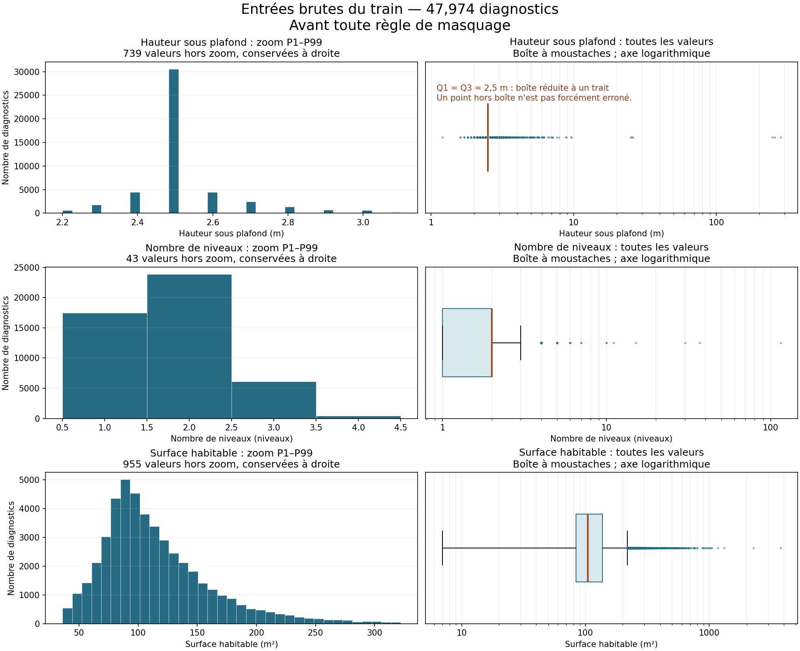

# Valeurs extrêmes dans le train

Nous avons regardé les distributions des **47 974 diagnostics du train brut**,
avant de remplacer des valeurs. Nous avons repris les identifiants du découpage
fixé ; les données de validation et de test ne servent pas à choisir les seuils.

Nous avions proposé le seuil de 10 avant de tracer ces graphiques.
Nous l'avons désactivé pour reprendre l'examen des valeurs suspectes.

## Distributions et boîtes à moustaches

À gauche, nous zoomons entre les percentiles 1 et 99 pour voir le centre de la
distribution. Le nombre de valeurs hors cadre est indiqué. À droite, nous gardons
toutes les valeurs sur un axe logarithmique.

| Variable | Médiane | P99 | Maximum dans train | Points hors règle 1,5 × IQR |
| --- | ---: | ---: | ---: | ---: |
| Hauteur | 2,5 m | 3,1 m | 282 m | 17 405 |
| Niveaux | 2 | 4 | 115 | 502 |
| Surface | 104,2 m² | 322,027 m² | 3 771 m² | 2 319 |

Pour la hauteur, Q1 = Q3 = 2,5 m : l'écart interquartile est nul.
La règle IQR signale donc toute autre hauteur, même 2,4 m ou 2,6 m.
Pour les niveaux, la borne de 3,5 signale les maisons de quatre niveaux.
Pour la surface, la borne de 217,95 m² ne correspond pas à une limite physique.
Nous ne pouvons donc pas supprimer automatiquement tous les points hors moustaches.

## Surface, hauteur et nombre de niveaux

Les cercles orange repèrent les huit plus grandes valeurs de l'axe vertical.
Nous voyons des hauteurs de centaines de mètres et des nombres de niveaux élevés
pour des surfaces ordinaires. Nous devons regarder les fiches et les unités
pour comprendre ces cas.

## Les plus grandes valeurs

- **Hauteur :** les valeurs de 25–26 m et de 246–282 m sont isolées ; la plus grande
  valeur suivante est de 9,6 m. Nous soupçonnons une erreur d'unité ou de décimale,
  mais nous ne savons pas encore quelle correction appliquer.
  Les petites hauteurs de 1,2–1,7 m sont aussi à vérifier.
- **Niveaux :** 115, 37, 30, 15 et 11 sont à examiner. Les valeurs 10 et 11 restent
  proches : le graphique ne suffit pas à choisir une coupure à 10.
- **Surface :** 3 771 m² et 2 272 m² sont rares, mais leur taille seule ne suffit
  pas à conclure à une erreur. Nous les gardons pour le moment.

Nous avons regroupé les huit plus grandes et les cinq plus petites valeurs par
variable dans [extreme_records.csv](../reports/outliers_train/extreme_records.csv),
avec les numéros de diagnostic et les autres caractéristiques.
Une même fiche peut apparaître plusieurs fois si elle ressort pour plusieurs variables.

## Suite

Nous avons repéré les valeurs à examiner ; nous n'avons pas encore fixé
leur traitement. Pour l'instant, nous gardons les valeurs brutes.
Le seuil de 10 reste une option à essayer, puis à comparer sur train/validation.
Nous gardons le test pour l'évaluation finale et nous ne corrigeons pas
les unités sans avoir vérifié les fiches.

Pour refaire les graphiques : `python scripts/inspect_outliers.py`.
Le script produit les trois figures, les statistiques et le tableau de fiches,
sans modifier les données.
