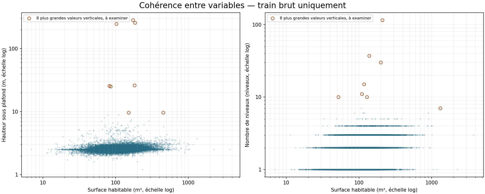

# Examen visuel avant de décider le traitement

L'analyse porte uniquement sur les **47 974 diagnostics du train brut**, sélectionnés
par les identifiants de la séparation fixe. Ni la validation ni le test ne servent
à choisir des seuils. La source et les affectations restent inchangées.

Le seuil de 10 avait été proposé avant ces graphiques. Cette chronologie est
conservée explicitement : les figures ne sont pas présentées comme la justification
initiale de cette proposition. Le masquage est désormais désactivé par défaut.

## Distributions et boîtes à moustaches

À gauche : zoom entre les percentiles 1 et 99, avec le nombre de valeurs hors zoom.
À droite : toutes les valeurs sur un axe logarithmique ; les valeurs extrêmes ne
sont pas supprimées. Le zoom sert uniquement à rendre la distribution lisible.

| Variable | Médiane | P99 | Maximum dans train | Points hors règle 1,5 × IQR |
| --- | ---: | ---: | ---: | ---: |
| Hauteur | 2,5 m | 3,1 m | 282 m | 17 405 |
| Niveaux | 2 | 4 | 115 | 502 |
| Surface | 104,2 m² | 322,027 m² | 3 771 m² | 2 319 |

**La règle IQR ne doit pas servir de filtre automatique.** Pour la hauteur,
Q1 = Q3 = 2,5 m : l'écart interquartile est nul et la règle signale toute autre
hauteur, y compris 2,4 m ou 2,6 m. Pour les niveaux, la borne supérieure de 3,5
signale même des maisons de quatre niveaux. Pour la surface, 217,95 m² est une
borne statistique, pas une limite physique.

## Cohérence entre variables

Les cercles orange indiquent les huit plus grandes valeurs de l'axe vertical,
sans les déclarer erronées. Des hauteurs de centaines de mètres et de nombreux
niveaux apparaissent pour des surfaces résidentielles ordinaires : ces combinaisons
justifient une vérification des fiches et des unités.

## Valeurs de queue et fiches correspondantes

- **Hauteur :** les valeurs 25–26 m et 246–282 m forment des points isolés, au-dessus
  d'un groupe dont les plus grandes valeurs suivantes sont 9,6 m. Une erreur
  d'unité ou de décimale est plausible, mais les graphiques ne prouvent pas la
  correction à appliquer. Les petites hauteurs de 1,2–1,7 m méritent aussi examen.
- **Niveaux :** 115, 37, 30, 15 et 11 sont à vérifier ; les valeurs 10 et 11 sont
  proches. La figure ne prouve pas qu'une frontière à 10 soit la bonne règle.
- **Surface :** 3 771 m² et 2 272 m² sont rares ; leur taille seule ne prouve pas
  une erreur. On conserve ces valeurs en attendant des éléments supplémentaires.

Le tableau [extreme_records.csv](../reports/outliers_train/extreme_records.csv)
contient les huit plus grandes et les cinq plus petites valeurs par variable,
avec leurs numéros de diagnostic et les autres caractéristiques. Une même fiche
peut apparaître plusieurs fois lorsqu'elle est sélectionnée pour plusieurs raisons.

## Décision à ce stade

Les valeurs sont **repérées, pas automatiquement corrigées**. Il reste à établir
une règle motivée après examen des cas, puis, si nécessaire, à comparer sa
sensibilité sur train/validation. Ne pas corriger une unité supposée sans preuve,
ni supprimer toutes les observations hors moustaches. L'ancienne règle au seuil
de 10 reste une option expérimentale explicite, et non une politique validée.

Reproduction : `python scripts/inspect_outliers.py`. Le script produit trois
figures, les statistiques et le tableau de fiches, sans changer les données.
